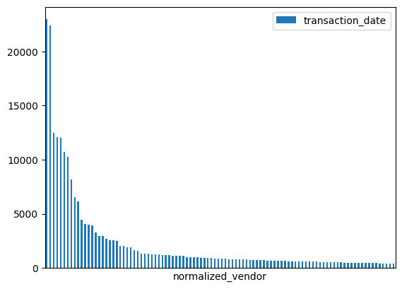
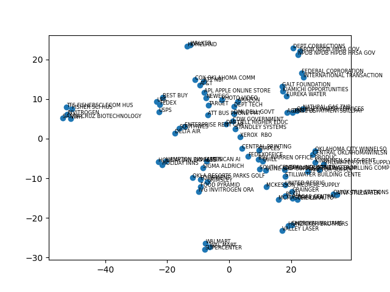
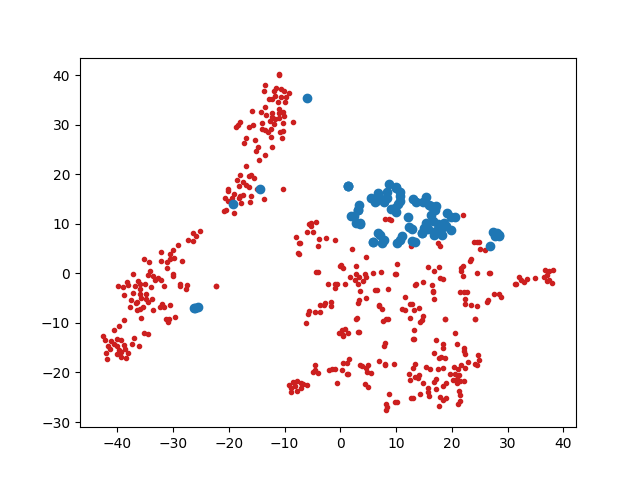
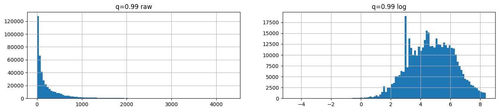
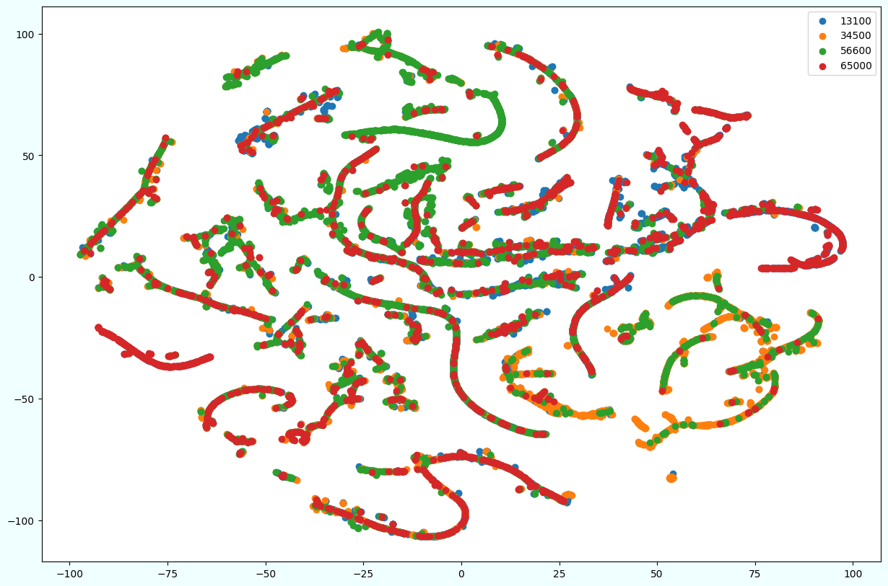
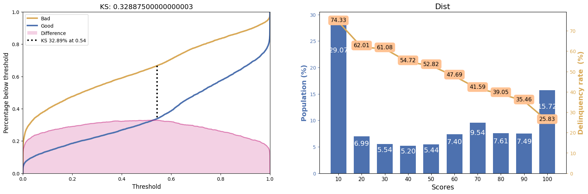
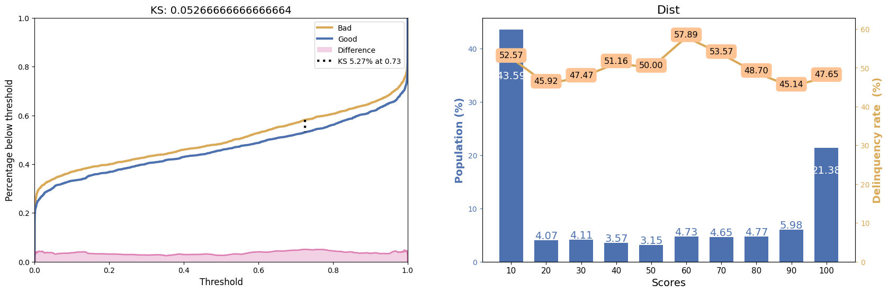

# Transaction embeddings for anomaly detection in purchase-card data

An end-to-end machine learning case study on about 440k corporate purchase-card (P-card) transactions from government agencies. It starts from raw, messy transaction records and works up to learned transaction embeddings and a model that flags transactions that don't fit an agency's spending pattern. Along the way it covers text normalization, fuzzy matching, web-crawled vendor descriptions, sentence-transformer embeddings, metric learning with a triplet loss and a set-based classifier.

## The problem

Fraud labels aren't available, so the project uses a proxy task. Given 20 past transactions from one agency, is a new transaction from that same agency? A transaction that looks unlike its agency's recent history is a candidate for review.

## Pipeline

The notebooks are numbered and run in order.

| Step | Notebook / script | What it does |
|---|---|---|
| 01 | `01-parse-dates-and-amount.ipynb` | Loads the raw CSV (442,458 rows), parses dates and amounts and drops the unparseable rows. 442,183 rows are left. |
| 02 | `02-vendors-clean-up.ipynb`, `normalize_vendor.py` | Rule-based vendor-name normalization (accents, punctuation, stop words, merchant-specific rules). It cuts 86,727 raw vendor strings to 30,647. |
| 02.02 | `02.02-vendors-compute-sims-trigrams.py`, `02.02.01`, `02.02.02` | Trigram similarity between every pair of vendors, stored as a 30k × 30k sparse matrix, plus a t-SNE map of the vendor space. |
| 02.03 | `02.03.01` to `02.03.03` | The top 100 vendors cover 42% of transactions. Their websites were crawled with [python-vendor-crawler](https://github.com/cassinaooo/python-vendor-crawler) and the text embedded with `sentence-transformers/all-mpnet-base-v2`, one 768-d vector per vendor. |
| 03 | `03.01-mcc-to-vector.ipynb`, `03.01-mcc-tsne.ipynb` | The same sentence embeddings for the 434 Merchant Category Code (MCC) descriptions. |
| 04 | `04.01-mix-vendor-and-mcc.ipynb` | A joint SVD and t-SNE view of the vendor and MCC vectors. |
| 05 | `05.01-preprocess.ipynb` | Clips and log-transforms amounts, then builds a 1,537-feature transaction vector: amount, vendor embedding and MCC embedding. |
| 06 | `06.01-triplet-loss.ipynb` | Trains a 7-layer MLP (1537 → 32) with a triplet margin loss, so transactions from the same agency land close together. |
| 07 | `07.01-fraud-detection.ipynb` | Freezes the embedding network and trains a classifier on 20 context transactions plus 1 challenger. It uses 80k balanced synthetic examples. |
| 08 | `08.01` to `08.03` | Evaluation: t-SNE of the test embeddings, KS/precision/recall on held-out data, and a test on agencies never seen in training. |

## A few things the notebooks show

**Spending is concentrated in a few vendors.** Transaction counts for the top 100 normalized vendors fall off steeply, so crawling only those 100 websites still covers 42% of all transactions (`02.03.01`).



**Embedding the crawled website text groups vendors by what they sell.** In a t-SNE of the 100 vendor vectors, name variants of the same merchant (Walmart, Wal-Mart, Supercenter) collapse together, and hotels, shipping/electronics retailers and government agencies form their own neighbourhoods (`02.03.03`).



**Vendor and MCC vectors live in different regions.** In a joint SVD + t-SNE, the vendor vectors (blue) sit apart from the 434 MCC description vectors (red), even though both come from the same sentence-transformer. Long website copy and short category labels land in different parts of the embedding space. The transaction vector in step 05 keeps them as two separate blocks of features (`04.01`).



**Amounts are heavy-tailed.** Even after clipping at the 99th percentile, raw amounts pile up near zero, and a log transform gives a usable, roughly bell-shaped feature (`05.01`).



**The learned embeddings separate agencies only partly.** A t-SNE of 18,000 test transactions from the four training agencies, after the triplet-loss network, shows long single-agency streaks, but the agencies interleave across the map instead of forming four clusters. That matches the weak Davies-Bouldin score (3.66) below (`08.01`).



## Results

| Evaluation | KS | Precision | Recall | F1 |
|---|---|---|---|---|
| Held-out transactions, agencies seen in training (16k) | 0.329 | 0.665 | 0.662 | 0.664 |
| Agencies not seen in training (3k) | 0.053 | 0.530 | 0.470 | 0.498 |

The KS and score-bucket plots make the gap visible. In each pair, "Bad" is a challenger from a different agency, "Good" is one from the same agency, and the right-hand line is the share of different-agency challengers in each score decile.

On held-out transactions from the training agencies, the two cumulative curves pull apart (KS 0.33). The share of different-agency challengers falls steadily from 74% in the lowest score decile to 26% in the highest (`08.02`):



On agencies never seen in training, the curves almost overlap (KS 0.05). The share stays between 45% and 58% in every decile, so the score carries almost no information (`08.03`):



The model learns a useful signal for the agencies it was trained on. It does **not** generalize to unseen agencies: its performance there is close to chance. The embedding clusters are also only weakly separated (Davies-Bouldin 3.66). Natural next steps would be training on many more agencies and adding the time between purchases and the cardholder's own history as context.

## Running it

```bash
python -m venv .venv && source .venv/bin/activate
pip install -r requirements.txt
```

Every numbered notebook/script should run in order, given `./data/V2_ENG_interview_dataset.csv`. The raw data isn't included in this repository.

You can also fetch all the data from a bucket with `gsutil cp gs://hyperplane-ml-bucket/data/ ./data` (6.2G). If you want access to this bucket, please request it.

`plothelpers.py` has the small KS / score-distribution / PSI plotting helpers used in the evaluation notebooks.

## License

MIT, see [LICENSE](LICENSE).
